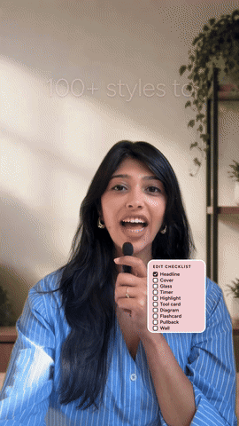
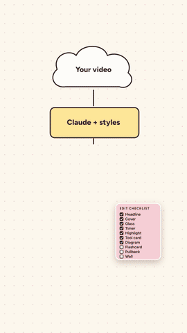

# growwithak style pack

103 Instagram Reel editing styles you order by hashtag. Film one vertical talking-head take, pick styles like `#butterhook #checklist #pill`, and Claude Code edits it into a finished 9:16 Reel: pauses cut, voice cleaned, a mockup first, then a 4K render.

**See every style:** open the [Reel Menu](https://growwithakai-cloud.github.io/growwithak-style-pack/) (or `docs/index.html` in this repo). Tap "+ Add this style" on the ones you like, then "Copy prompt".

## See it in action

A real Reel edited with the pack: one take, pauses cut, a style on every idea.

<p align="center">
  
</p>

| `#cover` | `#glass` | `#timer` | `#highlight` |
|:-:|:-:|:-:|:-:|
|  |  |  |  |
| A magazine-style title behind you | Frosted glass panels around you | A ring timer counts up to the number | An article quote, highlighted |
| `#toolcard` | `#diagram` | `#flashcards` | `#pullback` |
|  |  |  |  |
| A tool, its platforms and price | A simple animated explainer | Flashcards flip through features | Your shot pulls back into an app |
| `#wall` | `#counter` | `#comment` | `#checklist` |
|  |  |  |  |
| A wall of your past thumbnails | A numbered series counter | A comment-to-get call to action | Steps tick off as you go (3× speed) |

Every style in the pack is in the [Reel Menu](https://growwithakai-cloud.github.io/growwithak-style-pack/).

## What you need

- A Mac or Windows computer with the Claude desktop app (the **Code** tab) or Claude Code in a terminal.
- About 5 minutes, once. On your first edit Claude checks for Node.js and ffmpeg, explains each step in plain words and asks before installing anything.

## Install (pick one)

**A. Drag the zip (easiest).** [Download the pack (.zip)](https://growwithakai-cloud.github.io/growwithak-style-pack/growwithak-style-pack.zip), open the Claude app, click the Code tab, drag the zip into the chat and say:

```
install this skill for me
```

**B. One command.**

```bash
npx skills add growwithakai-cloud/growwithak-style-pack
```

**C. As a Claude Code plugin.** Type these into Claude Code, one at a time:

```
/plugin marketplace add growwithakai-cloud/growwithak-style-pack
/plugin install growwithak-style-pack@growwithak
```

Check it worked by saying `show me the growwithak styles`. The Reel Menu opens in your browser.

## Your first edit

1. Film one vertical take in good light, with some plain wall above your head. Say the trigger words out loud (each style's "Say it on" line in the menu).
2. Open the Reel Menu, add 4 to 6 styles and press **Copy prompt**.
3. Paste it into Claude Code and replace `<path to my video>` with your file, for example:

   ```
   Use the growwithak-style-pack skill to edit ~/Downloads/IMG_1234.MOV with #butterhook #checklist #pill
   ```

4. Claude replies with a short order card and asks only for what your styles need (a real comment, a logo, a screenshot). It never invents comments, stats or screenshots.
5. You get stills and a draft video. Say yes, or ask for changes. The 4K render comes after your yes. Your original video is never changed.

## Make it yours

The pack ships in the **Peach Sorbet** theme: white, butter `#FFE59A`, blush `#F9CFD6` and cocoa `#3B2626`, with the Fraunces and Figtree fonts. Every colour, font and your handle live in one file, `skills/growwithak-style-pack/theme.json`. Change its `value` fields, or just tell Claude:

```
Change the growwithak style pack theme to my colours #1E3A5F #FFD166 and my handle @yourname
```

## What's inside

```
skills/growwithak-style-pack/
  SKILL.md        how Claude takes your order, what it asks for, setup and house rules
  styles.md       the recipe for every one of the 103 styles
  theme.json      your colours, fonts and handle
  fonts/          Fraunces and Figtree (SIL Open Font License)
  guide/          the Reel Menu, one file that works offline
docs/             the same Reel Menu for a website, plus the zip
media/            the preview GIFs in this README
.claude-plugin/   lets Claude Code install this as a plugin
tools/            rebuilds the Reel Menu and the zip (python3 tools/build_guide.py)
```

The styles are built with [HyperFrames](https://github.com/heygen-com/hyperframes) (HTML to video), which Claude runs with `npx`, so there is nothing extra to install.

## Credit and licence

Made by **Grow with AK** ([@_growwithak](https://www.instagram.com/_growwithak/)). Free to use on your own videos, including paid client work. Please credit @_growwithak if you share the pack, and don't resell it. See [LICENSE](LICENSE). The fonts are under the SIL Open Font License (`skills/growwithak-style-pack/fonts/OFL.txt`).
